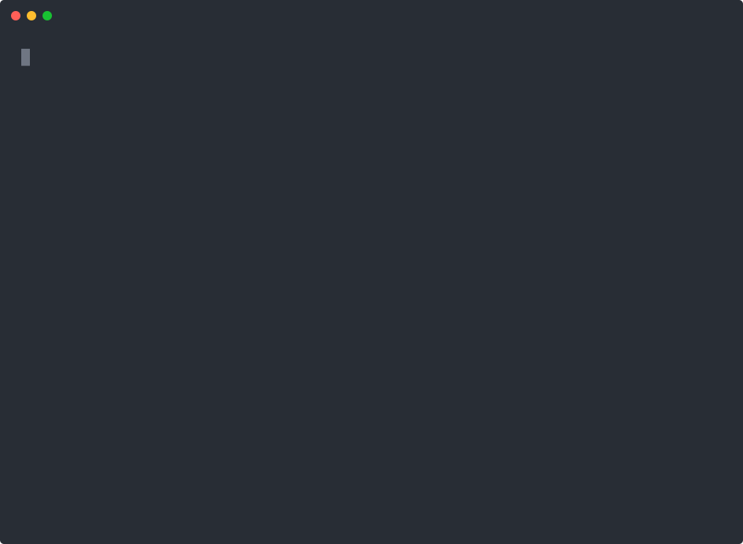
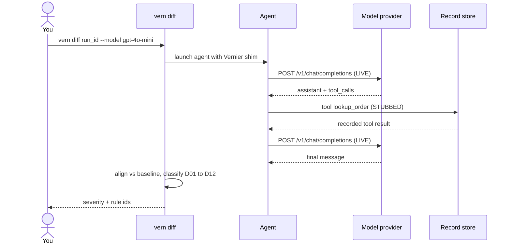
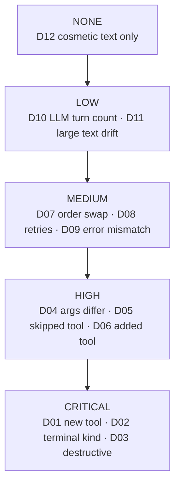

# Vernier

[](https://scorecard.dev/viewer/?uri=github.com/GautamTalksDev/Vernier)

Vernier answers one question: did my agent's behaviour change, and is it safe to ship?

## 30-second quickstart

You need Python 3.11+ and [uv](https://github.com/astral-sh/uv).

```bash
uv sync
uv run vern gate --corpus testdata/verify --max-severity HIGH
```

Watch for every fixture landing at `severity=NONE` and a final `exit=0` (recording from a real run on this repo; regenerate with `scripts/record_quickstart_demo.sh`):



Same text, if you prefer reading it static:

```text
01_tools_basic: severity=NONE rules=[]
02_stream: severity=NONE rules=[]
…
10_stream_tools: severity=NONE rules=[]
vern gate: worst=NONE threshold=HIGH n=10
exit=0
```

Exit code `0` means every run stayed at or below your severity cap. Exit `1` means at least one run was too severe. Exit `2` means the tool itself failed (bad record, replay miss, crash).

## The problem

You bump a model id in CI. Tests still pass. Customers still hit a new failure mode.

Here is a concrete case. Your support agent used to call `lookup_order` then `refund`. After a quiet model change it skips the lookup and refunds from memory. Unit tests that mock the tools never notice. An LLM-as-judge score might still look "fine". The behaviour changed, and you shipped it.

Vernier records what the agent actually did (tool calls, HTTP, order). You re-drive against a new model. It aligns the two trajectories and fires fixed rules (for example "tool set changed" or "destructive call without the prior lookup"). You get a severity and rule ids you can fail CI on.

## How it works

Look for the LLM going **live** to the provider while **tools** come back from the record. That split is the whole point of live-diff.



### Record

You wrap the command you already run. Vernier does not ask you to edit the agent.

```bash
uv run vern record -- python examples/verify_fixture_agent.py --scenario 01_tools_basic
```

That writes an append-only run under `.vernier/runs/<run_id>/`: event lines plus content-addressed blobs. The record is the evidence.

### Re-drive

You run the same agent again under Vernier's shim.

- `vern verify`: full stub. LLM and tools come from the record. Use this to prove the substrate can reproduce a run.
- `vern diff` / `vern gate`: live LLM (optional model override), tools stubbed from the record. Use this to ask whether a model or prompt change changed behaviour.

```bash
uv run vern diff <run_id> --model gpt-4o-mini
```

### Align

Two trajectories become one edit script (match, insert, delete, substitute). Costs come from a versioned table, not from an embedding. Same inputs always produce the same alignment bytes on Linux, macOS, and Windows.

### Classify

Fixed rules D01 to D12 read the aligned pair and emit severity levels (`NONE` through `CRITICAL`) plus rule ids. There is no model on this path. That is deliberate: a judge that can change its mind tomorrow cannot be your CI contract. If classification ever needs a coin flip or a network call, Vernier is broken.

Look for which rule ids sit on each severity rung. Run severity is the **maximum** among fired rules.



The full rule table lives in [`SPEC-DIVERGENCE.md`](SPEC-DIVERGENCE.md). Pipeline shape: [`docs/ARCHITECTURE.md`](docs/ARCHITECTURE.md).

## What it will not do

- **No LLM judge.** Classification is code and tables you can unit test. A soft "looks okay" score is not a ship gate.
- **No similarity scores.** Alignment and rules use exact structure and a fixed word-edit check where the spec says so. Nothing fuzzy decides severity.
- **Tools are stubbed on re-drive.** Live-diff asks the new model what to do; tool results come from the record. That isolates the model variable. It also means Vernier does not prove your live tools still work.
- **Providers are nondeterministic.** Even at temperature 0, two live calls can differ. Treat live-diff as evidence, not as a mathematical identity proof. Use `vern verify` (full stub) when you need a hard reproduce check.
- **Vernier does not phone home.** The only network it uses is the model provider you already configured.

## Kill tests

These are the project stop conditions. They are not softened.

| Kill test | Text | Status |
| --- | --- | --- |
| **KT-1** | If a single-variable model-version change produces behavioural divergence in fewer than 20% of 30+ recorded real agent runs, agents are robust to the change people actually make, there is no pain, and this project stops. | **UNEVALUATED** |
| **KT-2** | If the classifier cannot agree with hand-labelled ground truth on >=85% of divergences AND catch 100% of behavioural divergences, it is worse than useless: it is a false green light in CI, and this project stops. | **UNEVALUATED** |
| **KT-3** | If a full-stub re-drive of 10 recorded runs of >=8 steps each does not produce a 100% action match, the substrate is broken and nothing above it means anything. | **PASS** |
| **KT-3b** | If a live-diff re-drive with no model/prompt override (unchanged variable) does not return severity NONE, the live-diff harness is broken by definition and KT-1/KT-2 results are void. | **PASS** |
| **KT-4** | If nobody has put `vern gate` in a CI pipeline unprompted within 3 months of launch, there is no business here. | not due |

Details and dates: [`RESULTS.md`](RESULTS.md). A prior write-up claimed KT-1/KT-2 pass on a broken harness. Do not cite it: [`RESULTS-v0-RETRACTED.md`](RESULTS-v0-RETRACTED.md).

## Install

```bash
uv sync
uv run vern --help
```

Or install the package once you publish it:

```bash
uv pip install vernier-cli
vern --help
```

## CI usage

Scaffold a workflow, record a corpus, then gate:

```bash
vern init
vern gate --corpus vernier-corpus --max-severity MEDIUM
```

GitHub Action (your provider key only; Vernier adds no secrets of its own):

```yaml
- uses: gautamtalksdev/Vernier@main
  with:
    corpus-path: vernier-corpus
    max-severity: MEDIUM
```

More copy-paste for GitHub and GitLab: [docs/CI.md](docs/CI.md).

## Spec and further reading

| Doc | What it is |
| --- | --- |
| [`SPEC-DIVERGENCE.md`](SPEC-DIVERGENCE.md) | Normative classifier (CC0) |
| [`docs/ARCHITECTURE.md`](docs/ARCHITECTURE.md) | Record / re-drive / align / classify shape |
| [`docs/CI.md`](docs/CI.md) | Putting `vern gate` in a pipeline |
| [`docs/THREAT-MODEL.md`](docs/THREAT-MODEL.md) | What we treat as hostile input |
| [`CONTRIBUTING.md`](CONTRIBUTING.md) | How to send a change |
| [`SUPPORT.md`](SUPPORT.md) | How to ask for help |

## License

Apache License 2.0. See [LICENSE](LICENSE), [NOTICE](NOTICE), and
[docs/THIRD-PARTY.md](docs/THIRD-PARTY.md).

`SPEC-DIVERGENCE.md` is [CC0 1.0](https://creativecommons.org/publicdomain/zero/1.0/).
Evaluation datasets under `testdata/` are
[CC BY 4.0](https://creativecommons.org/licenses/by/4.0/).
