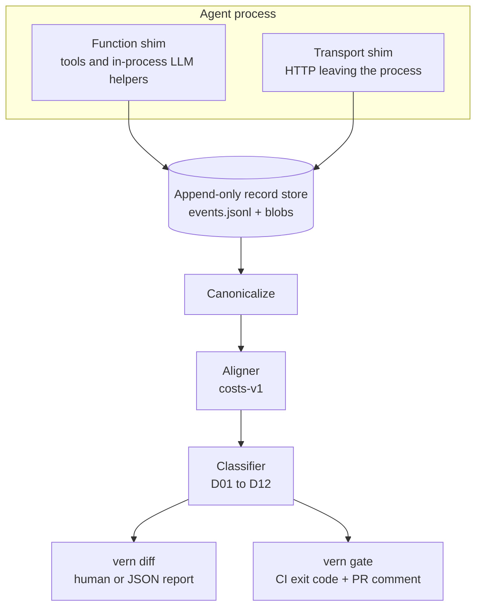

# Architecture

You need to know where evidence comes from before you trust a severity number.

Vernier records agent behaviour on two planes, stores one ordered run, then aligns and classifies without calling a model.

## Picture

Look for the two capture planes feeding one record store, then the shared align and classify path splitting into `vern diff` and `vern gate`.



## Function shim

When your agent calls a wrapped tool or LLM helper in-process, Vernier records the call and result as events.

```python
from vernier.capture import tool

@tool
def lookup_order(order_id: str) -> dict:
    return db.fetch(order_id)
```

A later re-drive can stub that tool from the record so the new model still sees the same tool result bytes.

## Transport shim

When the process talks HTTP (for example OpenAI-compatible chat), Vernier records method, URL (with secrets redacted), headers (blocked names dropped), and body digests or blobs.

```bash
uv run vern record -- python examples/simple_agent.py
# events.jsonl gains LlmRequest / LlmResponse rows
```

Why both planes: tools that never hit the network still matter for behaviour, and LLM traffic that never goes through your `@tool` wrapper still matters too.

## Record store

Runs live under `.vernier/runs/<run_id>/`:

```text
events.jsonl   CRC-prefixed event envelopes (source of truth)
blobs/         content-addressed payloads
manifest.json  metadata + root digest
```

There is no update and no delete. If a file changes underfoot, `vern verify-record` should fail.

## Align and classify

Alignment turns two trajectories into an edit script with a fixed cost table (`costs-v1`). Classification applies D01 to D12 from [`SPEC-DIVERGENCE.md`](../SPEC-DIVERGENCE.md).

Why no LLM on that path: CI needs the same bytes tomorrow. A judge that drifts is not a contract.

## Package map

| Package | Role |
| --- | --- |
| `vernier.capture` | Function + transport shims |
| `vernier.record` | Append-only store |
| `vernier.canonical` | Canonicalization + hashing (no I/O) |
| `vernier.align` | Trajectory alignment |
| `vernier.classify` | Deterministic divergence rules |
| `vernier.report` | Human + JSON output |
| `vernier.cli` | `vern` CLI entrypoint |
